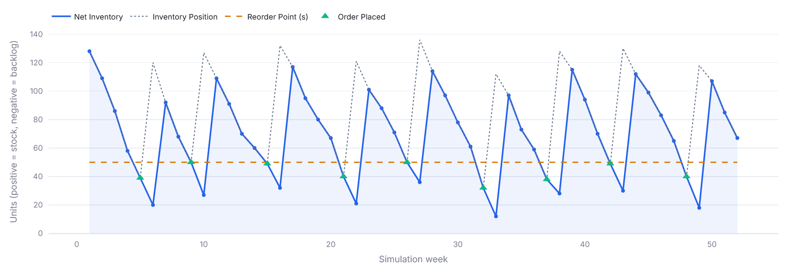
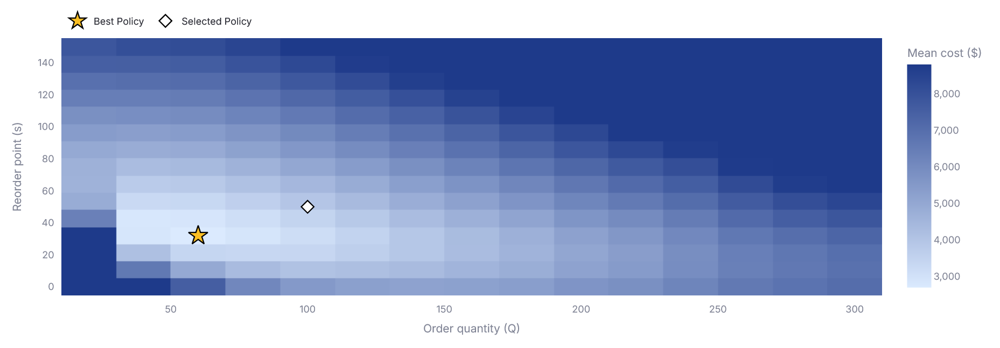

# SupplyChainX: Stochastic Inventory Simulator

An interactive simulator for a core supply chain question: **when and how much should a company reorder when demand is uncertain?**

**[Live demo ↗](https://supplychainx.streamlit.app)** &nbsp;no installation needed (if the app is asleep, click the wake-up button and wait a moment)

 
&nbsp;Built with Python · Streamlit · NumPy · pandas · Plotly

<table>
  <tr>
    <td width="50%"></td>
    <td width="50%"></td>
  </tr>
  <tr>
    <td align="center"><sub>Inventory trajectory of a single simulation run</sub></td>
    <td align="center"><sub>Policy scan: mean cost for every combination of s and Q</sub></td>
  </tr>
</table>

## Motivation

A company that holds stock has to decide **when to reorder** (the reorder point *s*) and **how much to order** (the order quantity *Q*). Demand is random, so every policy is a trade-off: too little stock causes backorders and poor service, too much stock ties up capital and causes holding costs, and many small orders cause high ordering costs. The best policy depends on the demand variability, the lead time and the costs, and with random demand the effect of a policy is hard to predict by hand.

SupplyChainX simulates the **(s, Q) policy** week by week, so you can see how it behaves, what it costs, how reliable the result is, and which policy is cheapest.

**Example.** In the default scenario (mean demand 20 per week, σ = 5, lead time 2 weeks, 52 weeks, 100 runs, both policies facing the same demand), the policy scan finds a much cheaper policy than the default (50, 100), but it pays for this with service:

| Policy (s, Q) | Mean total cost | Mean fill rate | Runs with backorders |
|---|---|---|---|
| Default (50, 100) | \$3,766.61 | 99.95% | 13% |
| Cheapest in the scan (32, 60) | \$2,697.55 (−28.4%) | 96.61% | 100% |

The cheapest policy has backorders in every run, because at \$10 per unit and week it is cheaper to accept them than to hold the extra stock that would avoid them. Whether that is acceptable is a business decision. This is exactly the trade-off the app makes visible.

## Features

| Tab | What it shows |
|---|---|
| **Inventory Trajectory** | Net inventory (stock in blue, backlog in red), inventory position, reorder point and every order over time |
| **Cost Breakdown** | Holding, backorder and ordering costs and their shares of the total cost |
| **Monte Carlo** | Distributions of total cost and fill rate over 50–1,000 runs, mean with 95% confidence interval, 5th–95th percentile band of the inventory, share of runs with backorders |
| **Policy Optimization** | Heatmap of the mean cost over a grid of up to 15 × 15 combinations of reorder point and order quantity, best policy and its fill rate |
| **Weekly Log & Export** | The complete weekly simulation table and a CSV download |

The main key figures are compared with the default scenario, all random results are reproducible through a seed, and the app explains its model and every parameter in the interface.

## Model

A single item is managed with a **periodic-review (s, Q) policy**. Each week, in this order:

1. **Deliveries** that are due arrive, before the demand of the week occurs.
2. **Demand** occurs and is served from stock on hand. Unserved demand is backordered, and later arrivals clear the backlog first.
3. **Reorder check** at the end of the week: if the *inventory position* (net inventory plus open orders) is at or below *s*, one order of *Q* units is placed. At most one order is placed per week.
4. **Costs** are charged on the end-of-week state: $h \cdot \text{stock on hand} + b \cdot \text{backlog}$ per week, plus $K$ for each order placed.

| Symbol | Meaning | Default |
|---|---|---|
| *s*, *Q* | Reorder point, order quantity | 50, 100 |
| *μ*, *σ* | Mean and standard deviation of the weekly demand | 20, 5 |
| *L* | Lead time in weeks | 2 |
| *h*, *b*, *K* | Holding cost, backorder penalty (both per unit and week), fixed cost per order | \$1, \$10, \$50 |

- **Demand** is normally distributed, rounded to whole units and set to 0 if negative. If σ is large relative to μ, this raises the effective mean demand to $E[\max(0, X)] = \mu\,\Phi(z) + \sigma\,\varphi(z)$ with $z = \mu / \sigma$. The app shows a warning and the effective mean.
- **Fill rate** is the share of the total demand served immediately from stock in the week it occurs. It is not the cycle service level.
- **Timing.** An order placed at the end of week *t* arrives at the start of week *t* + *L*, before that week's demand. It is therefore exposed to the demand of *L* − 1 full weeks. Keep this in mind when comparing results with textbook formulas that use *L*.
- **Randomness.** The same seed gives the same results. Run 1 of the Monte Carlo analysis equals the single run, and the policy scan evaluates all policies on the same demand histories (common random numbers), which reduces the noise in cost differences.

## Model validation

- **Theory:** The economic order quantity $\text{EOQ} = \sqrt{2\mu K/h}$ is 44.7 in the default scenario. A precise scan (2,000 runs per policy) finds the cheapest order quantity at about 50, and Q = 45 (the rounded EOQ) costs less than 1% more. The cost curve is flat there, so the app's quick default scan (100 runs, coarse grid) can land a little off; it reports Q = 60. The effective demand formula matches the simulation (μ = 20, σ = 30: 24.53 by formula, 24.57 simulated).
- **Independent implementation:** A separate re-implementation written in a different style gives identical results on random scenarios.
- **Tests:** 65 automated tests cover the model, the charts and the app. In a mutation check with 18 deliberately injected bugs, they detected every one. They pass on Python 3.9 to 3.13 and on 3.15.

## Getting started

Requires Python 3.9 or newer.

```bash
git clone https://github.com/denn-zell/SupplyChainX.git
cd SupplyChainX

# Optional: a virtual environment keeps the packages separate from your other projects
python -m venv .venv
.venv\Scripts\activate          # Windows (PowerShell); on macOS/Linux: source .venv/bin/activate

python -m pip install -r requirements.txt
python -m streamlit run app.py
```

The app opens in your browser, by default at `http://localhost:8501` (the terminal shows the exact address). To run the tests:

```bash
python -m pip install -r requirements-dev.txt
python -m pytest
```

## Project structure

`simulation.py` is the model, `charts.py` builds the Plotly figures, `constants.py` holds defaults, colors and texts, `app.py` is the Streamlit interface, and `tests/` contains the automated tests. The model does not depend on the interface: `simulation.py` imports none of the other files, `constants.py` imports only `simulation.py`, `charts.py` only `constants.py`, and only `app.py` knows Streamlit.

## Limitations

This is a deliberately compact teaching model, not a decision system for production use. It assumes:

- a single item at a single stocking point,
- independent, normally distributed weekly demand with known parameters,
- a fixed, known lead time and full backordering (no lost sales),
- one review per week and at most one order per week, which restricts policies with a small *Q* relative to the demand,
- no capacity limits, quantity discounts or minimum order sizes.

The policy scan is a grid search on a finite number of simulated runs, and near the optimum the cost surface is flat, so the best policy it reports is an estimate. Possible extensions: random lead times, other demand distributions and seasonality, lost sales, (s, S) policies, a service-level target as a constraint, and multi-echelon networks.

---

Licensed under the [MIT License](LICENSE). © 2026 Dennis Zeller
